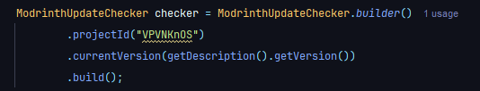
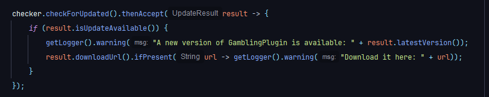

# ModrinthUpdateChecker

A simple update checker for Minecraft plugins/mods using the Modrinth API.

- Requires Java 21+
- Dependency: Gson only
- Fully asynchronous (`CompletableFuture`), with typed exceptions

## Getting started

### 1. Add the repository and dependency

Groovy DSL (`build.gradle`):

```gradle
repositories {
    mavenCentral()
}

dependencies {
    implementation "de.winniepat:modrinthupdatechecker:0.0.1"
}
```

Kotlin DSL (`build.gradle.kts`):

```kotlin
repositories {
    mavenCentral()
}

dependencies {
    implementation("de.winniepat:modrinthupdatechecker:0.0.1")
}
```

Maven (`pom.xml`):

```xml
<dependency>
    <groupId>de.winniepat</groupId>
    <artifactId>modrinthupdatechecker</artifactId>
    <version>0.0.1</version>
</dependency>
```

### 2. Create the checker

In your plugin's main class:

```java
ModrinthUpdateChecker checker = ModrinthUpdateChecker.builder()
        .projectId("YOUR_MODRINTH_PROJECT_ID") // Project ID or slug, found on the Modrinth project page
        .currentVersion(getDescription().getVersion()) // Your plugin's/mod's current version
        .loader("paper")   // optional: only consider versions for this loader
        .gameVersion("1.21.4") // optional: only consider versions for this game version
        .build();
```

The project accepts both the **project ID** and the **slug** — for a project
at `https://modrinth.com/mod/example-mod`, the slug is `example-mod` and is
easiest to copy.

Create the checker once and reuse it across checks; each instance owns its
HTTP client. When your plugin is disabled, release it:

```java
@Override
public void onDisable() {
    checker.close();
}
```

### 3. Check for updates

In your `onEnable()` method, check for updates:

```java
checker.checkForUpdates().thenAccept(result -> {
    if (result.isUpdateAvailable()) {
        getLogger().warning("A new version is available: " + result.latestVersion()
                + " (you are running " + result.currentVersion() + ")");
        result.downloadUrl().ifPresent(url ->
                getLogger().warning("Download it here: " + url));
        result.changelog().ifPresent(changelog ->
                getLogger().info("What's new: " + changelog));
    }
}).exceptionally(error -> {
    // Unwrap the thrown exception (errors arrive as CompletionException)
    Throwable cause = error.getCause();
    getLogger().warning("Could not check for updates: " + cause.getMessage());
    return null;
});
```

`checkForUpdates()` runs on the common ForkJoinPool. To use a different
executor (e.g. your server's async scheduler), pass it:

```java
checker.checkForUpdates(yourAsyncSchedulerExecutor);
```

## What you get from a check

| Method | Description |
| ------ | ----------- |
| `currentVersion()` | The version you configured |
| `latestVersion()` | Version number of the newest listed release |
| `versionId()` | Modrinth-internal version ID |
| `versionName()` | Display name the author gave the release |
| `versionType()` | `release`, `beta` or `alpha` |
| `publishedAt()` | Release timestamp (`Instant`) |
| `downloadUrl()` | Direct URL of the primary file |
| `fileName()` / `fileSize()` | Primary file name / size in bytes |
| `changelog()` | Markdown changelog (needs `.includeChangelog()`) |
| `isUpdateAvailable()` | `true` if the newest release is strictly newer |

`isUpdateAvailable()` uses a lenient version comparison: a leading `v` is
ignored (`v1.2.0 == 1.2.0`), numbers compare numerically (`1.10 > 1.9`),
missing trailing parts count as zero (`1.2 == 1.2.0`), and a release is newer
than a `-beta` or `-Snapshot` of the same core version. If your installed
version is *newer* than everything on Modrinth (e.g. a dev build), no update
is reported.



## Errors

Checks fail asynchronously as subclasses of `ModrinthException`; catch them
(or reuse them for logging) via `.exceptionally` / `.whenComplete`:

| Exception | Meaning |
| --------- | ------- |
| `ProjectNotFoundException` | Project ID/slug does not exist (HTTP 404) |
| `RateLimitException` | Modrinth rate limit hit (HTTP 429); back off `retryAfterSeconds()` |
| `NoCompatibleVersionException` | Project exists, but no listed version matches loader/game version filters |
| `ModrinthApiException` | Other unexpected HTTP statuses; see `statusCode()` |
| `ModrinthException` | Base class; network/I-O failures with the `IOException` as cause |

Check results depend on the Modrinth API being reachable — schedule checks
with a delay (e.g. once every hour) rather than every tick, and always handle
failure gracefully.

## User-Agent

Modrinth's docs ask clients to send a descriptive `User-Agent` with contact
information. The default identifies this library and its version
(`WinniePatGG/ModrinthUpdateChecker/<version> (+https://github.com/WinniePatGG/ModrinthUpdateChecker)`);
supply your own via `.userAgent(...)` if you prefer:

```java
.userAgent("myplugin/1.0.0 (+https://github.com/you/myplugin)")
```



## License

[MIT](LICENSE)
